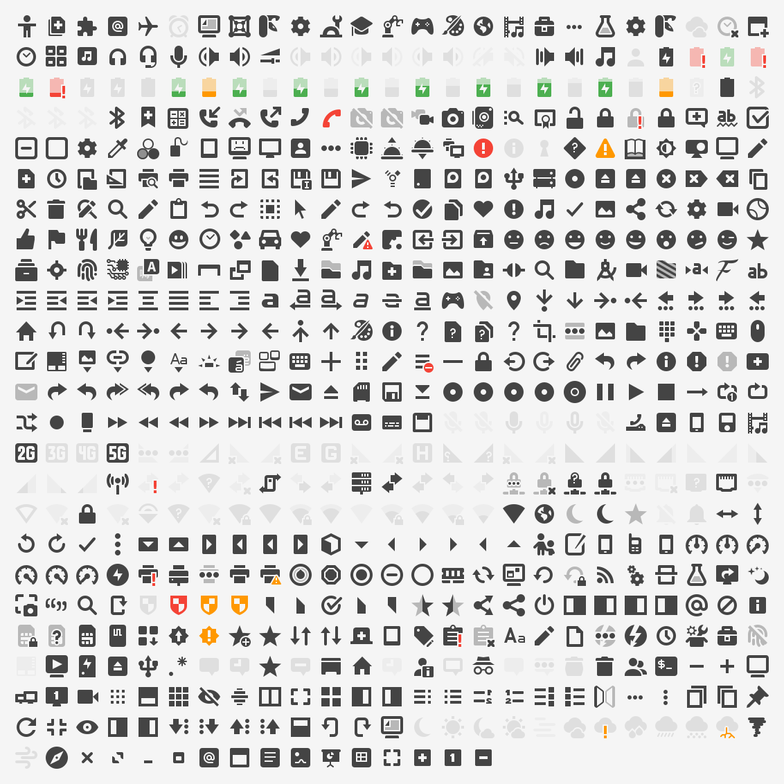

# papirus-xapp-symbolic-icons

[Papirus](https://github.com/PapirusDevelopmentTeam/papirus-icon-theme)-styled
versions of the [xapp-symbolic-icons (XSI)](https://github.com/xapp-project/xapp-symbolic-icons)
set used by Linux Mint, Cinnamon, and the XApp projects.

XSI ships its own Adwaita-derived artwork into `hicolor`, so applications
using `xsi-*` icon names look out of place under the Papirus theme. This
project provides the same icon names drawn from Papirus artwork, installed
into the Papirus theme directories so `xsi-*` lookups resolve to
Papirus-styled icons before falling back to hicolor.



## Coverage

**616 of the 666 XSI icon names (92%)** are currently provided. The
remaining 50 have no Papirus equivalent yet; they are listed in
`mapping/unmapped.txt` and will keep resolving to the stock XSI artwork in
hicolor until they are themed.

Unlike upstream XSI (16×16 only), icons are provided at every size Papirus
draws them — 16, 22, and 24 px — so panels and applets that render symbolic
icons above 16 px get properly pixel-grid-aligned artwork instead of scaled
16 px icons.

## Theme variants

Only the base `Papirus` theme directory is populated. `Papirus-Dark` and
`Papirus-Light` symlink their symbolic icon directories into `Papirus`, and
symbolic icons are recolored at render time, so all variants are covered by
the one set.

## Install

System-wide (into `/usr/share/icons/Papirus`):

```sh
sudo make install
```

Per-user (into `~/.local/share/icons/Papirus`, merged with the system theme
by icon lookup):

```sh
make install-user
```

Remove with `sudo make uninstall` / `make uninstall-user`. The Papirus icon
theme itself must be installed for the icons to be used.

## Regenerating

The icon set is generated — nothing under `icons/` is hand-edited.
Sources are vendored as git submodules:

```sh
git submodule update --init --depth 1
make icons
```

- `tools/build_mapping.py` — matches upstream XSI names against the Papirus
  symbolic inventory. Matching uses hand-verified overrides
  (`mapping/overrides.tsv`), exact names, and upstream's own equivalence
  data (the adwaita→xsi rename table, the old `xapp-*` names, and
  byte-identical alias groups); `-rtl` names fall back to mirroring the LTR
  icon. Writes `mapping/mapping.tsv` and `mapping/unmapped.txt`.
- `tools/suggest_matches.py` — review aid; lists fuzzy Papirus candidates
  for still-unmapped names.
- `tools/generate.py` — builds `icons/Papirus/<size>/symbolic/<context>/`
  from the mapping (plain copies, plus horizontally mirrored SVGs for RTL
  variants Papirus doesn't draw).

To sync with new upstream releases, update the submodules and rerun
`make icons`.

## Licensing

Icons are derived from the Papirus icon theme and, like it, are distributed
under the [GPL-3.0](LICENSE).

The `xsi-*` icon naming scheme comes from the
[xapp-project/xapp-symbolic-icons](https://github.com/xapp-project/xapp-symbolic-icons)
project (LGPL-3.0). No XSI artwork is included in the generated set.
